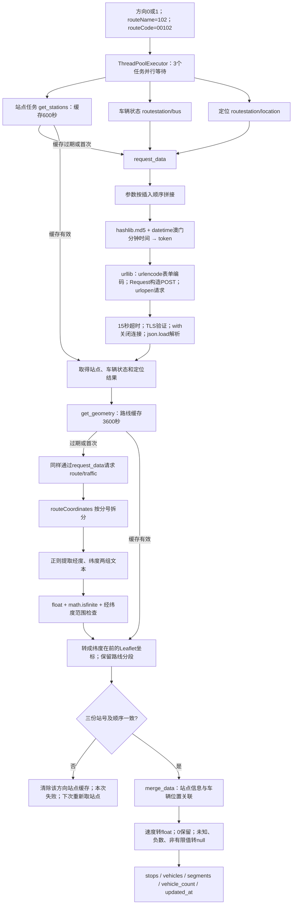
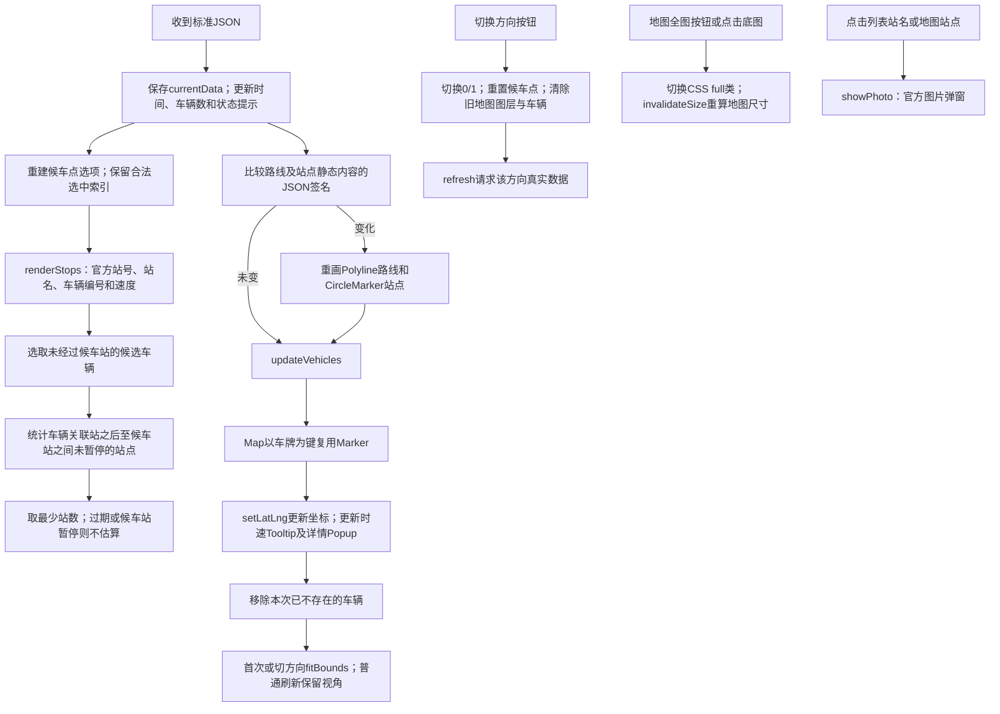

# 澳门102巴士项目：实现流程与技术作用

依据当前 collector.py、app.py、static/app.js 整理。主链路为：官方数据 → Python采集 → 校验与合并 → 内存缓存 → Flask JSON接口 → JavaScript → Leaflet地图与候车界面。

## 1. 总体流程

```mermaid
flowchart TD
    START[运行 python app.py] --> SERVER[Flask 本地服务 127.0.0.1:5000]
    SERVER --> PAGE[GET / → render_template → index.html]
    PAGE --> ASSETS[加载 CSS、原生 JavaScript、本地 Leaflet]
    ASSETS --> TRIGGER[首次加载 / 每10秒 / 手动刷新 / 切换方向]
    TRIGGER --> GATE{前端是否正在请求?}
    GATE -->|是| SKIP[跳过重复刷新]
    GATE -->|否| FETCH[Fetch API 请求 /api/route]
    FETCH --> LOCK[检查方向0或1；threading.Lock保护采集与缓存]
    LOCK --> TTL{距上次尝试达到间隔?}
    TTL -->|否| CACHE[读取该方向最新内存结果]
    TTL -->|是| COLLECT[collect：并行获取站点、车辆状态、定位]
    COLLECT --> GEO[获取该方向路线折线，使用1小时缓存]
    GEO --> CHECK[检查成功码、站号和站序、坐标与速度]
    CHECK --> MERGE[merge_data：按站号及站序合并站点；按车牌合并车辆]
    MERGE --> SAVE[更新该方向内存缓存与采集完成时间]
    SAVE --> JSON[Flask jsonify 返回标准JSON]
    CACHE --> JSON
    COLLECT -. 异常 .-> FAIL[保留旧缓存并标 stale；无缓存返回503]
    GEO -. 异常 .-> FAIL
    CHECK -. 异常 .-> FAIL
    MERGE -. 异常 .-> FAIL
    FAIL --> JSON
    JSON --> FRONT[JavaScript保存 currentData]
    FRONT --> STOPS[renderStops：站点列表、车辆栏、候车站数]
    FRONT --> MAP[updateMap：路线折线、站点、车辆与速度]
    MAP --> OSM[Leaflet展示；OpenStreetMap提供底图瓦片]
    STOPS --> DONE[finally恢复刷新和方向按钮]
    MAP --> DONE
    ASSETS --> SOURCE[/api/source：采集HTML并正则提取标题]
    SOURCE --> LABEL[textContent显示来源名称]
    STOPS --> PHOTO[点击站名 → /api/photo/站号 → 官方照片弹窗]
    PAGE --> TABLE[HTML固定班次表：按官方原表人工录入]
```

自动刷新仅在页面可见时触发；手动刷新请求附带 refresh=1。后端普通请求最短间隔10秒，手动最短5秒。两个方向分别保存缓存，但当前使用同一把路由锁，采集过程会互相等待。

## 2. 数据采集与处理细节



四个数据接口基址为 https://bis.dsat.gov.mo:37812 ：

| 数据     | 路径                                   | 用途                                 |
| ------ | ------------------------------------ | ---------------------------------- |
| 站点资料   | /macauweb/getRouteData.html          | 官方站号、站名、车道、暂停状态；虽以html结尾，响应按JSON解析 |
| 车辆状态   | /macauweb/routestation/bus           | 各站关联车辆、车牌、车辆编号、状态                  |
| 位置与速度  | /macauweb/routestation/location      | 车辆与站点坐标、车辆速度                       |
| 真实道路折线 | /ddbus/common/supermap/route/traffic | 两个方向分别提供路线分段坐标                     |

## 3. 三处正则的流程与作用

| 位置                           | 表达式                    | 输入与输出           | 作用                                                        |
| ---------------------------- | ---------------------- | --------------- | --------------------------------------------------------- |
| collector.py / extract_title | `<title>(.*?)</title>` | HTML → title内文字 | re.search配合re.I、re.S查找标题；group(1)提取；unescape解码实体；strip去空白 |
| app.py / parse_route_points  | `([^,]+),([^,]+)`      | 单个经纬度字符串 → 两组文本 | re.fullmatch确保整个字段只有两部分；数字和范围交给coordinates校验              |
| app.py / photo               | `[MTLC]\d+(?:/\d+)?`   | 站号 → 通过或拒绝      | re.fullmatch限制照片参数格式，再转换官方图片文件名                           |

标题流程：GET官方index.html → UTF-8解码 → 正则查找 → 检查匹配与空标题 → HTML实体解码 → /api/source返回 → textContent显示。独立锁及1小时尝试间隔使其与车辆刷新分离，失败不影响动态数据。

坐标流程：`113.56,22.14;113.57,22.15;` → split(';') → 跳过空项 → 正则分组 → float转换与有限值/范围检查 → `[[22.14,113.56],[22.15,113.57]]`。

照片流程：点击站点 → encodeURIComponent编码站号 → Flask路由 → 正则校验 → M800/7转换为m800_7.jpg，L17转换为l17_1.jpg → 官方图片GET（12秒超时）→ 检查Content-Type → 返回图片及24小时浏览器缓存头 → dialog显示；失败提示无照片。

只有第一处是HTML信息提取，其他两处是坐标文本提取和参数校验。主要业务数据使用json.load解析，不用正则解析JSON。

## 4. 前端交互流程



路线条车辆位置来自官方站点关联；地图车辆位置来自经纬度。两者不是同一种定位。路线条通过getBoundingClientRect记录旧位置，再用Web Animations API做650ms过渡，不生成虚构轨迹；遵守prefers-reduced-motion。

## 5. 技术与职责总表

| 层次     | 技术                                        | 在项目中的作用                                              |
| ------ | ----------------------------------------- | ---------------------------------------------------- |
| 运行     | Python、pip、requirements.txt               | 安装Flask并运行后端                                         |
| Web服务  | Flask、render_template、Jinja模板机制           | 提供首页和三个数据/照片接口；加载HTML模板                              |
| HTTP输出 | jsonify、Response、状态码                      | 输出JSON或图片；区分无效参数400、图片失败404、无数据503                   |
| 采集     | urllib.request / urllib.parse             | HTTP GET/POST、表单编码、请求头及超时                            |
| 请求格式   | hashlib.md5、datetime/timezone             | 按官方前端规则构造token，使用澳门UTC+8时间；MD5不是加密                   |
| 结构解析   | json.load                                 | 把官方JSON转换为Python字典和列表                                |
| 文本处理   | re、html.unescape                          | 标题提取、坐标字段提取、站号验证、HTML实体解码                            |
| 数据清洗   | float、math.isfinite、条件判断                  | 坐标范围校验；未知速度标准化；保留速度0                                 |
| 并行     | concurrent.futures.ThreadPoolExecutor     | 并行等待站点、车辆状态和定位任务                                     |
| 并发保护   | threading.Lock                            | 保护缓存和采集；HTML标题使用独立锁                                  |
| 缓存计时   | 字典、time.monotonic                         | 内存保存各方向结果，使用单调时间判断过期                                 |
| 异常处理   | try/except、Flask日志、stale                  | 留下异常日志，保留旧结果并明确过期                                    |
| 页面结构   | HTML、select、dialog                        | 三板块布局结构、候车点选择、照片弹窗、固定班次表                             |
| 页面样式   | CSS                                       | 路线条、车辆栏、滚动区域、响应式与全图布局                                |
| 请求与调度  | JavaScript Fetch、async/await、setInterval  | 异步请求；10秒轮询；页面隐藏时跳过自动刷新                               |
| 超时与状态  | AbortSignal.timeout、busy、try/finally      | 请求超时、防重复请求、结束后恢复按钮                                   |
| DOM更新  | createElement、textContent、replaceChildren | 生成站点与车辆界面，避免将上游文本作为HTML执行                            |
| 前端数据结构 | Map、Set、数组筛选排序                            | 车牌关联Marker、移除消失车辆、估算最近候选车辆站数                         |
| 动画     | Web Animations API、matchMedia             | 路线条车辆位置过渡与减少动画偏好支持                                   |
| 地图引擎   | 本地Leaflet                                 | Polyline路线、CircleMarker站点、Marker车辆、Tooltip速度、Popup详情 |
| 地图服务   | OpenStreetMap瓦片                           | 浏览器直接加载地图底图；不提供巴士数据                                  |
| HTTP缓存 | Cache-Control                             | 动态API no-store；照片浏览器可缓存86400秒                        |
| 时间显示   | ISO时间、Date.toLocaleTimeString             | 后端记录采集完成时间，前端按Asia/Macau显示                           |
| 质量检查   | unittest、unittest.mock                    | 验证解析、数据清洗、方向隔离、缓存和异常逻辑                               |
| 版本管理   | Git / GitHub                              | 保存和分享项目代码；不参与实时数据运行链路                                |

## 6. 缓存与结果边界

| 内容     | 时间/策略                       | 保存位置                          |
| ------ | --------------------------- | ----------------------------- |
| 动态采集   | 普通最短10秒；手动最短5秒              | 后端states，各方向独立                |
| 站点资料   | 600秒                        | 后端station_cache               |
| 路线折线   | 3600秒                       | 后端geometries                  |
| HTML标题 | 每3600秒最多尝试一次                | 后端source_title/source_attempt |
| 照片     | Cache-Control max-age=86400 | 浏览器HTTP缓存；未实现服务器照片缓存          |
| 班次表    | 固定HTML表，手动更新                | templates/index.html          |

没有数据库、磁盘历史记录和历史回放。后端进程退出后内存缓存消失。失败保留的旧结果没有最长保存期限，页面会提示过期。站点坐标仍随定位接口每次获取。

展示边界：剩余站数为估算，不是到站时间预测；照片为官方实景图，不是实时摄像头；绿色表示路线，不表示交通畅通；车型未知；updated_at为采集完成时间，不是每车GPS更新时间。
